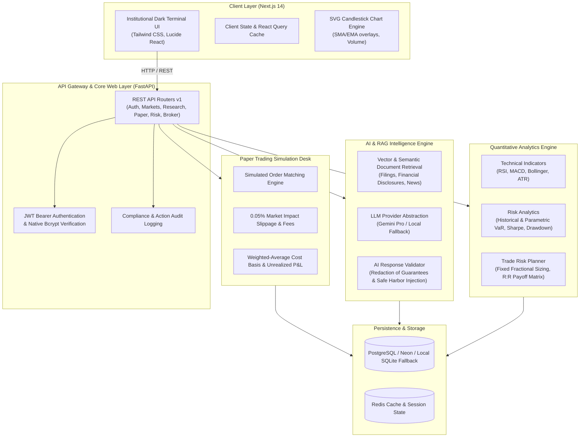

# FinPilot AI — System Architecture & Engineering Design

## 1. Architectural Philosophy

FinPilot AI is built on a fundamental institutional fintech principle:
> **"Deterministic code for mathematical execution; generative AI for grounded qualitative reasoning."**

Numerical calculations (returns, standard deviation, Value at Risk, Sharpe ratio, position sizing, order matching, slippage, and P&L attribution) are strictly executed using tested, deterministic Python functions with **NumPy** and **Pandas**. Generative AI models are strictly prohibited from hallucinating financial quantities or predicting live equity prices.

---

## 2. High-Level System Architecture Diagram

---

## 3. Layer Breakdown

### 3.1. Client Layer (Frontend)
- **Framework**: Next.js 14 using the modern App Router architecture (`src/app/`).
- **Styling & Aesthetics**: Hand-crafted institutional terminal theme using Tailwind CSS (`slate-950` primary palette, emerald for positive delta, rose for negative delta, indigo for interactive accents).
- **Charting**: Lightweight pure-SVG candlestick charting engine (`InteractiveCandleChart.tsx`) eliminating bloated external canvas dependencies while rendering high-DPI candlestick bodies, wicks, moving average ribbons, and volume bars with interactive tooltips.
- **Safety Indicators**: Prominent status badges (`[PAPER TRADE]`, `[SIMULATED]`, `[DELAYED 15m]`) embedded across all financial views.

### 3.2. API & Routing Layer (FastAPI)
- **Framework**: FastAPI (Python 3.10+) with asynchronous routing, dependency injection (`app.api.deps`), and automatic OpenAPI v3 documentation at `/docs`.
- **Modular Routers**:
  - `auth.py`: Registration, login, password reset, profile management.
  - `dashboard.py`: Consolidated market indices, user balance, watchlist snapshot, top movers.
  - `instruments.py`: Multi-market equity search (NSE/BSE in ₹ and US in $), OHLCV candle history, financial metrics.
  - `trade_planner.py`: Mathematical trade plan creation, ATR sizing, scenario matrix generation.
  - `paper_trading.py`: Buy/sell limit and market simulated orders, portfolio positions, transaction logs.
  - `research.py`: Deep-dive equity research reports with qualitative bull/bear theses and verified ratios.
  - `assistant.py`: Grounded AI conversational copilot with RAG document retrieval.
  - `risk.py`: Portfolio Value-at-Risk, Sharpe, Sortino, and customizable risk tolerance profile.
  - `portfolio.py`: Asset allocation, sector diversification (HHI index), P&L attribution.
  - `journal.py`: Trading journal with emotional state tracking and win-rate analytics.
  - `broker.py`: Mock broker integration adapters (Zerodha Kite, Angel One, Alpaca).
  - `admin.py`: Superuser controls, system health telemetry, user access toggles, AI token billing.
  - `legal.py`: Regulatory disclosures, privacy policies, terms of service.

### 3.3. Quantitative Analytics Layer
All numerical processing is isolated from the AI model in `app/analytics/`:
- **`indicators.py`**: Computes SMA, EMA, Wilder's smoothed RSI (handles zero-loss/zero-gain edge cases), MACD (12/26/9), Bollinger Bands (20 period, 2 std), Average True Range (ATR 14), and Stochastic Oscillator (%K, %D).
- **`risk_metrics.py`**:
  - Parametric Value at Risk (VaR 95% & 99% via normal distribution Z-scores).
  - Historical Value at Risk (empirical quantile distribution).
  - Maximum Drawdown (peak-to-trough equity decline and duration).
  - Annualized Sharpe Ratio & Sortino Ratio (downside deviation penalization).
  - Beta calculation vs market benchmark (NIFTY 50 or S&P 500).
- **`position_sizing.py`**: Fixed fractional position risk modeling:
  $$\text{Position Units} = \left\lfloor \frac{\text{Account Capital} \times \text{Risk \%}}{|\text{Entry Price} - \text{Stop Loss}|} \right\rfloor$$
- **`portfolio_math.py`**: Herfindahl-Hirschman Index (HHI) concentration metric and correlation matrix.

### 3.4. AI & RAG Intelligence Layer
- **Provider Abstraction**: Common interface supporting Google Gemini Pro and deterministic offline fallback (`FallbackFinancialAIProvider`).
- **Offline Resiliency**: In the absence of external API keys, the fallback engine uses deterministic NLP keyword matching, technical indicator summaries, and financial ratio synthesis to generate institutional reports without external network calls.
- **RAG Retrieval Engine**: Chunks regulatory filings (10-K, annual reports, earnings calls) and computes cosine similarity against user queries to inject cited knowledge into prompts.
- **Safety Guardrails (`response_validator.py`)**: Sanitizes model outputs, intercepts speculative claims or guaranteed return phrases (e.g., "guaranteed 20% gain", "risk-free trade"), and appends statutory disclaimers.

### 3.5. Paper Trading Execution Desk
- **Order Types**: Market and Limit orders for BUY and SELL.
- **Slippage Modeling**: Applies realistic 0.05% market impact penalty on execution price.
- **Turnover Fees**: Deducts simulated broker fees (0.03% or ₹20/$1 minimum).
- **Accounting**: Continuous weighted-average cost basis tracking for open positions; realized P&L recorded immediately upon order closure.

### 3.6. Dual-Database Storage Architecture
- **Production Mode**: PostgreSQL hosted on **Neon** with connection pooling (`asyncpg` / `psycopg2`).
- **Local Dev Mode**: Zero-configuration local SQLite database (`finpilot.db`) with automatic table creation and data seeding.
- **Alembic Migrations**: Full database schema versioning in `backend/alembic/`.
