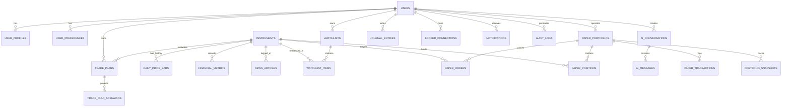

# FinPilot AI — Database Schema & Data Dictionary

FinPilot AI features a relational schema structured across 28+ tables designed for PostgreSQL (with Neon cloud deployment) and fully compatible with SQLite for local development.

---

## 1. Entity-Relationship Overview

---

## 2. Table Specifications

### 2.1. Authentication & User Management
#### `users`
| Column | Type | Constraints | Description |
| :--- | :--- | :--- | :--- |
| `id` | Integer | PK, Auto-increment | Primary identifier |
| `email` | String(255) | Unique, Indexed, Not Null | Account email address |
| `hashed_password` | String(255) | Not Null | Native bcrypt salted hash |
| `full_name` | String(255) | Nullable | Full name of the user |
| `role` | Enum | Not Null, Default `TRADER` | `ADMIN`, `PRO_TRADER`, `TRADER` |
| `is_active` | Boolean | Default True | Access state (toggleable by Admin) |
| `is_verified` | Boolean | Default False | Email verification state |
| `created_at` | DateTime (UTC)| Default Now | Account creation timestamp |
| `updated_at` | DateTime (UTC)| Default Now | Last profile modification |

#### `user_profiles`
Stores investor profiling and risk parameters:
- `user_id` (FK to `users.id`)
- `experience_level` (`BEGINNER`, `INTERMEDIATE`, `ADVANCED`)
- `risk_tolerance` (`CONSERVATIVE`, `MODERATE`, `AGGRESSIVE`)
- `max_capital_allocation` (Numeric)
- `max_risk_per_trade_pct` (Float, default 1.0%)

---

### 2.2. Market Instruments & Analytical Data
#### `instruments`
| Column | Type | Constraints | Description |
| :--- | :--- | :--- | :--- |
| `id` | Integer | PK, Auto-increment | Internal instrument ID |
| `symbol` | String(32) | Unique, Indexed | Ticker symbol (e.g. `RELIANCE.NS`, `AAPL`) |
| `name` | String(255) | Not Null | Corporate security name |
| `exchange` | Enum | Not Null, Indexed | `NSE`, `BSE`, `NASDAQ`, `NYSE` |
| `currency` | Enum | Not Null | `INR`, `USD` |
| `asset_class` | String(32) | Default `EQUITY` | Asset category |
| `sector` | String(128) | Indexed | Economic sector (e.g., Technology, Energy) |
| `is_active` | Boolean | Default True | Active trading status |

#### `daily_price_bars`
Stores historical and delayed daily OHLCV candlestick data:
- `id` (PK)
- `instrument_id` (FK to `instruments.id`, Indexed)
- `date` (Date, Indexed)
- `open`, `high`, `low`, `close` (Float)
- `volume` (BigInteger)
- `vwap` (Float, Nullable)

#### `financial_metrics`
Quarterly and TTM fundamental ratios:
- `instrument_id` (FK to `instruments.id`)
- `pe_ratio`, `pb_ratio`, `debt_to_equity`, `roe`, `roce`
- `operating_margin_pct`, `dividend_yield_pct`
- `market_cap_billions`, `beta_5y`

---

### 2.3. Trade Risk Planner
#### `trade_plans`
| Column | Type | Description |
| :--- | :--- | :--- |
| `id` | Integer (PK) | Plan identifier |
| `user_id` | Integer (FK) | Formulating user |
| `instrument_id` | Integer (FK) | Target equity |
| `direction` | Enum (`BUY`, `SELL`) | Planned directional bias |
| `entry_price` | Float | Planned entry level |
| `target_price` | Float | Planned profit target |
| `stop_loss` | Float | Invalidation price level |
| `account_capital`| Float | Total equity at time of plan |
| `risk_pct` | Float | User's risk budget (% of capital) |
| `calculated_qty` | Integer | Deterministic position size |
| `risk_reward_ratio` | Float | Calculated R:R (e.g., 2.50) |
| `status` | Enum | `DRAFT`, `ACTIVE`, `EXECUTED`, `CANCELLED` |

---

### 2.4. Paper Trading Execution Engine
#### `paper_portfolios`
- `id` (PK), `user_id` (FK, Unique)
- `starting_cash` (Float, default 1,000,000 INR / 100,000 USD)
- `current_cash` (Float)
- `currency` (`INR`, `USD`)

#### `paper_orders`
- `id` (PK), `portfolio_id` (FK), `instrument_id` (FK)
- `order_type` (`MARKET`, `LIMIT`)
- `side` (`BUY`, `SELL`)
- `quantity` (Integer)
- `limit_price` (Float, Nullable)
- `execution_price` (Float, Nullable, includes 0.05% modeled slippage)
- `fees_paid` (Float, simulated turnover & exchange charges)
- `status` (`PENDING`, `FILLED`, `REJECTED`, `CANCELLED`)
- `placed_at`, `filled_at`

#### `paper_positions`
- `id` (PK), `portfolio_id` (FK), `instrument_id` (FK)
- `quantity` (Integer)
- `average_entry_price` (Float, weighted average)
- `current_price` (Float)
- `unrealized_pnl` (Float)
- `realized_pnl` (Float)

---

### 2.5. AI & Grounded RAG Memory
#### `ai_conversations` & `ai_messages`
- Tracks session conversation threads, user inquiries, model responses, tokens consumed, citations, and risk disclaimers.

#### `ai_document_chunks`
- Vectorizable text segments from annual reports, 10-K filings, and company press releases.
- Fields: `instrument_id`, `chunk_text`, `source_title`, `filing_date`, `embedding_vector` (Pgvector / float array).

#### `ai_usages`
- Audit ledger for cost tracking: `user_id`, `prompt_tokens`, `completion_tokens`, `estimated_cost_usd`, `model_name`.

---

### 2.6. Simulated Broker Gateway & Audit Logging
#### `broker_connections`
- Holds mock OAuth tokens, simulated API keys, connection status for Zerodha Kite, Angel One, and Alpaca.

#### `broker_consent_logs`
- Regulatory audit table recording explicit user consent before any simulated order submission.

#### `audit_logs`
- Immutable system events: `timestamp`, `user_id`, `ip_address`, `action`, `status`, `details`.
